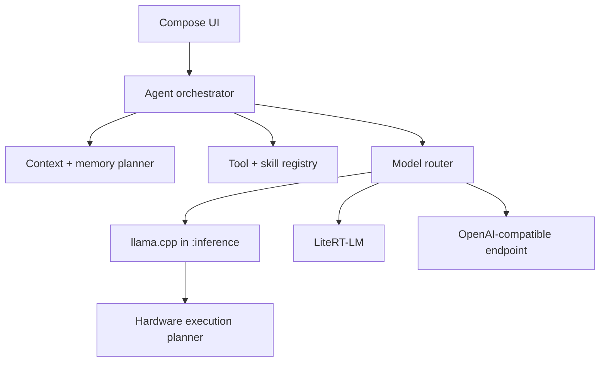

# Architecture

How Bram is put together, and why. For what works today see the
[project overview](docs/PROJECT_OVERVIEW.md); for what is next, the [roadmap](ROADMAP.md).

## Product principles

1. **Correctness and recovery.** A backend or tuning choice is measured against the CPU reference before
   it is used, and the measurement is recorded against a fingerprint of the device, app build,
   engine, and CPU features, so it expires when any of them change. A failure produces a more
   conservative retry, not a dead chat.
2. **Privacy controls.** Each conversation has a privacy class and each run a
   routing mode. Remote fallback cannot silently receive private content.
3. **Runtime-independent agent.** Agent behavior, tools, memory, skills, scheduling, and UI
   do not depend on llama.cpp, LiteRT-LM, or a remote API.
4. **Context budgeting.** A large model window is available to the planner, but relevance and
   predictable output headroom decide what enters a request.
5. **Skill activation.** An agent-created skill is a draft until the user
   activates it.
6. **Versioned identity.** Bram's persona is supplied to an agent run and versioned
   independently of the model, runtime, tools, and UI.

## Module map

| Module | Responsibility |
|---|---|
| `app` | Compose UI, view model, built-in tools, task queue and services, Bram's default identity, dependency assembly |
| `core:domain` | Runtime-neutral models and pure logic: contracts, routing pool, skills, cron, tuning, compatibility and model advice |
| `core:agent` | Orchestrator and tool loop, context planning, routing, execution planning |
| `platform:android` | Device profiling, conversation storage, SQLite memory and run journal, Keystore-backed stores |
| `runtime:openai` | OpenAI-compatible Chat Completions and Responses adapter over OkHttp |
| `runtime:llamacpp` | GGUF catalog and import, the `:inference` process and its AIDL protocol, pinned llama.cpp/JNI |
| `runtime:litertlm` | LiteRT-LM packages (`.litertlm`), loaded in the app process on CPU or GPU |

## Models, profiles, and runtimes

A `ModelDescriptor` is the user-visible model identity and a `ModelRuntime` is one way to run it:
the llama.cpp runtime for an imported GGUF, the LiteRT-LM runtime for a `.litertlm` package, or
the OpenAI-compatible runtime for an endpoint.

A **profile** (`ModelProfile`) is what a person picks: a GGUF plus a backend, context size,
sampler, reasoning setting, KV and attention settings, tuning knobs, and the measurements behind
them. Many profiles can point at one file. Import shows the file's size and fit for
confirmation, then creates a conservative profile from its metadata and loads it. Auto-configure
is offered on the profile rather than forced: eligible backends are measured against the CPU, and
the fastest one that agrees wins. The current setup pass explicitly excludes Vulkan;
manual Vulkan profiles and their validation remain available.

Agent identity is separate from model identity. Each run receives an `AgentIdentity` with a stable
ID, version, display name, and system prompt. Bram (`bram/0.1`, in `BramDefaults.kt`) is the
bundled default.

Runtime capabilities are probed, not inferred from the phone's model name. `MeasurementFingerprint`
combines the device hash, the app build, the llama.cpp commit, and the CPU feature flags; a profile
measured under a different fingerprint says so and asks to be re-measured.

The execution planner proposes CPU, GPU, NPU, hybrid, and storage-assisted candidates from the
model's weights, KV cache, compute buffers, and the current memory headroom. "Uses all hardware"
means every viable backend is considered and measured; it does not mean CPU, GPU, and NPU always
run at once.

The first-run guide uses the same facts from the other direction: `ModelAdvisor` (core:domain)
takes the RAM, free storage, CPU features, enumerated accelerators, and whether llama.cpp loaded at
all, and recommends a format, quant, and size before any model exists.

## Context and memory

The transcript is canonical and is never destructively summarized. Derived layers are replaceable:

| Layer | Purpose | Prompt behavior |
|---|---|---|
| Recent transcript | Exact conversational state, including tool calls and results | Preserved verbatim first; a call and its result are trimmed together |
| Working summary | What fell out of the window | Included when older turns are omitted |
| Facts, episodes, user instructions | Memories extracted from conversations | Retrieved by relevance |
| Skills | User-authored procedures | Active skills only, under their own section |
| Runtime cache | KV/prefix cache | Reused only for the same load identity and a matching prefix |

`ContextWindowManager` reserves output tokens before admitting input, and records what it included
and omitted. The local runtime supplies exact token counts; remote endpoints fall back to a
conservative estimate. The prompt is layered — identity, then profile instructions and skills, then
memories — and nothing lower can displace the harness prompt.

When a conversation exceeds the window, the newest coherent turn group is kept and the omitted
stretch is compacted by one bounded summarization pass into a `WORKING_SUMMARY` memory that keeps
the IDs of the messages it replaced. A failed compaction never fails the run.

Memories live in SQLite with an FTS index (`PersistentMemoryStore`). With an optional local
embedding model designated, recall fuses the keyword and vector rankings; without one it is keyword
recall alone. Tool results entering the transcript are capped by `ToolResultBudget` at roughly a
quarter of the context window, with a marker naming the original size.

## Agent loop

`DefaultAgentOrchestrator` runs up to `maxToolTurns` model/tool rounds (six by default). Each run:

1. selects tools once — a core set plus embedding-ranked extras within a budget proportional to the
   context window, with `tool_search` reaching anything not offered, and the tools an active skill
   declares added back;
2. plans the context, generates, and parses tool calls;
3. validates each call's arguments against its schema, then asks the approval gate;
4. runs approved calls under a per-tool timeout (read-only batches concurrently), and returns each
   result to the model, with its call ID, as untrusted content.

The gate's permission mode is per conversation: **Ask when needed** (`AUTO`: read-only tools run,
side effects ask), **Always ask** (`MANUAL`), and **Auto-approve** (`BYPASS`). Decisions are once,
for this run, or always for a scope; an "always" grant holds even under Always ask, and an
unanswered ask times out into a recorded refusal. A call recovered from plain text is never matched
by a remembered grant. Auto-approve runs everything without asking, except a recovered call once
the conversation holds content someone else authored (a fetched page, another app's screen),
because then the "call" may be the model repeating what it read.

The built-in tools are platform APIs rather than a filesystem: device status, notes and app files,
web search and fetch, clipboard, notifications and reminders, intents, contacts, calendar, weather,
memory search, skills, a user-granted document folder, screen reading and interaction through an
accessibility service Bram's user enables, and Termux. Remote MCP servers add their tools through
the same gate. Arbitrary shell access is not a built-in capability; see below.

## Skills

A skill is a versioned, user-authored procedure in a `SKILL.md`-style document: front matter with
`name`, `version`, and `description` (and optionally `author`, `tools`, and `permissions`), then the
instructions. `SkillLibrary` (core:domain) owns the lifecycle and `PersistentSkillStore` keeps it in
one `skills.json` with a schema version, atomic writes, and quarantine of a corrupt file.

- A skill a user imports is active; a new version of a known skill lands as a draft.
- The agent can propose a skill (`propose_skill`); its drafts stay drafts until the user activates
  them, and review shows a diff against the active version.
- Versions are monotonic, approval is tracked per version, and rollback restores the newest
  approved one.
- Active skills are rendered into the prompt as authored text, not code: a skill cannot act on its
  own or override what the user asks. Declared permissions are recorded for review and still ask at
  the gate.

## Tasks, automations, and background work

Android is not a Unix server and cannot promise unrestricted cron execution, so scheduled work is
built from alarms and a queue:

- **Tasks** (`AgentTaskRunner`) are named prompts that run one at a time on the application scope,
  each in its own conversation. A task due while no model is loaded is deferred until one loads.
- **Automations** are five-field cron schedules (`Cron`, core:domain). `AutomationRunner` gives each
  one a one-shot `setAndAllowWhileIdle` alarm for its next fire and chains the next on firing; the
  fire enqueues a task. A `BootReceiver` re-arms everything after a reboot or app update, since
  Android clears alarms then.
- **Reminders** from `schedule_notification` use exact alarms when the user has granted them and
  inexact ones otherwise.

The model runs in `:inference`; what needs protecting is the work driving it. Agent runs belong to
an application-scoped coroutine scope, and a foreground service holds the process for the loaded
model's lifetime — started on load, stopped on unload or when `:inference` dies — with the model,
backend, and current phase in its notification. A remote turn holds the service only for its own
duration. Stopping is a user action, not a consequence of navigation.

Every unattended run has a tool-turn budget, a routing policy, and a journal entry
(`SqliteRunJournal`) with its outcome.

## Conversations

Conversations are stored as one JSON file each with a rebuildable index, rather than a single
blob: a thread grows without bound, and rewriting every conversation to append a message would slow
down as Bram is used. Messages carry ordered activity entries for reasoning and tool calls, so the
transcript can collapse agent work to a line without discarding it, and assistant tool calls and
tool results are stored with matching IDs so later turns replay them.

## Process and failure isolation

Native inference belongs in `:inference`, a separate Android process exposed through AIDL. The
service, its JNI bridge, and native library live together in `runtime:llamacpp`; this avoids a
module dependency cycle and prevents model browsing from loading native code in the UI process.
The UI process owns conversation state and checkpoints prompts before generation. If a driver or
native backend crashes, the UI marks the loaded plan unavailable while keeping the chat visible.

The AIDL control plane uses JSON payloads so the contract can evolve before the native protocol
stabilizes. Token deltas currently use one-way Binder callbacks. Once physical profiling identifies
Binder overhead, deltas can move to a pipe/shared-memory transport while control remains in AIDL.

A load is identified by model, context, offload plan, backend filter, reasoning setting, KV-cache
and attention settings, batch sizes, and every tuning knob together. Treating any of these as
incidental is not safe: an early version keyed only on model and
context, so switching from CPU to GPU silently reused the CPU-resident model and reported the
accelerator as agreeing perfectly with itself.

Model bytes are copied into app-private storage at import and loaded from that path. Handing native
code a `/proc/self/fd` path for a document-provider descriptor does not work under scoped storage,
which refuses the re-open that llama.cpp performs internally.

When the native library cannot load at all — absent for the device's ABI, or corrupt — every binder
call answers with `nativeRuntimeLinked: false` and a reason instead of letting the
`UnsatisfiedLinkError` kill `:inference` on a binder thread.

## Accelerator validation

Compiling a backend says nothing about whether it computes correctly. Bram records a deterministic
greedy decode on CPU and requires an accelerator to reproduce it before reporting it as validated.

The comparison is teacher-forced: both backends receive the identical reference token sequence and
are asked only for the next-token prediction at each position. Free-running generation cannot be
scored, because one differing token sends the remainder somewhere unrelated and a small numerical
difference becomes indistinguishable from a broken kernel. Exact equality is also the wrong bar,
since a quantized accelerator legitimately disagrees on near-ties; the threshold is near-total
agreement.

This is not defensive over-engineering. A GPU backend on the target device reports success, raises
no driver error, and returns all-zero logits past a handful of offloaded layers. A speed comparison
called it working.

## Running code on Android

Two consequences of one platform rule shape what Bram's agent can be, so they are recorded here
rather than rediscovered as failed attempts.

Android blocks `execve()` on files under an app's data directory for apps targeting API 29 and
above — a write-xor-execute policy enforced through SELinux. Bram targets well above that. The only
sanctioned way for an app to execute native code it ships is from the APK's native library
directory, which is where Bram's own `.so` files already live and is not a general-purpose place to
put downloaded binaries.

**Bram cannot host stdio MCP servers.** That transport works by spawning the server as a child
process. Streamable HTTP is the transport Bram can support, so its MCP story is remote servers plus
in-process native tools. Most published servers are stdio, so this is a real limitation and is
stated as one rather than left for a user to discover.

**Bram will not ship its own shell.** Doing so means a Termux-sized userland — shell, coreutils,
package management — with every binary repackaged as a library, on a path the platform keeps
tightening. Termux itself stays on an old `targetSdkVersion` to avoid the rule and is rebuilding its
packaging to escape that dependence.

Instead Bram delegates to Termux when the user has it, through Termux's `RUN_COMMAND` intent, and
the execution restriction remains Termux's problem to solve. This is the widest capability Bram
offers — running commands as the user — so it sits behind the tool permission model rather than
beside it. Termux being absent, not configured for external apps, or refusing the permission are
all ordinary outcomes, and Bram reports them as conditions rather than failures.

## Remote providers and routing

`OpenAiCompatibleRuntime` speaks both Chat Completions and the Responses API, chosen per endpoint,
with tool calls, SSE streaming, and reasoning surfaced as Thinking rows. It runs on OkHttp so that
Stop cancels a stream parked in a socket read; the reasoning is in
[the networking decision](docs/NETWORKING-CLIENT-DECISION.md). The domain API exposes no wire
types, and provider quirks live in one `ProviderProfile`.

Errors are classified: 408, 429, 5xx, and connection failures are retried with backoff before any
token arrives; other 4xx responses are configuration errors, not retried. `EndpointHealth` marks a
failing endpoint down for 60 seconds so routing skips it.

Every turn is routed. Each chat runs on the profile chosen in its model sheet (the routing pool's
Primary target, with an optional server profile beside it); the sheet also sets, per chat, whether
the model reasons first and how tool calls are approved. `RoutingWorkloadClassifier` marks a
demanding request (substantial code, a long request, several weak signals together) so the router
weights quality more heavily, but it never swaps the chosen model for another.
`RuleBasedModelRouter` then scores only candidates that pass hard gates:

- the conversation's privacy class (Local only rejects every remote candidate) and the routing mode
  (Auto, Local only, Remote only);
- required capabilities such as tool calling, and context size;
- availability, including endpoint health and whether a local model can load.

The rest of the eligible candidates are kept in score order as fallbacks, so a turn that fails on
its first pick retries down the list, never across a hard gate, with the status line naming the
runtime that took over.
