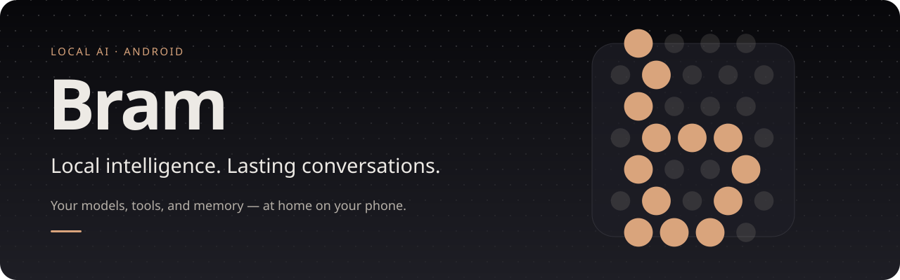
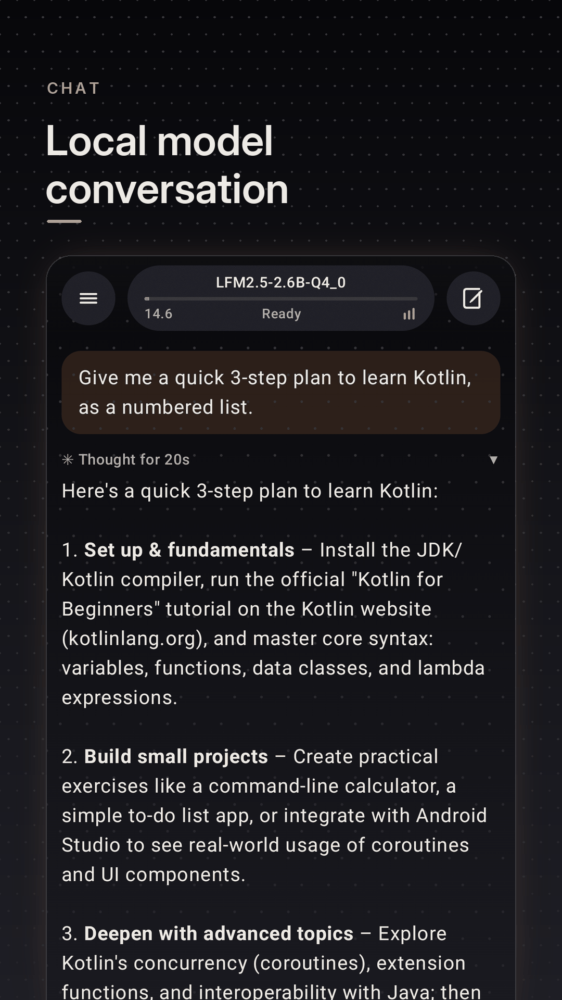
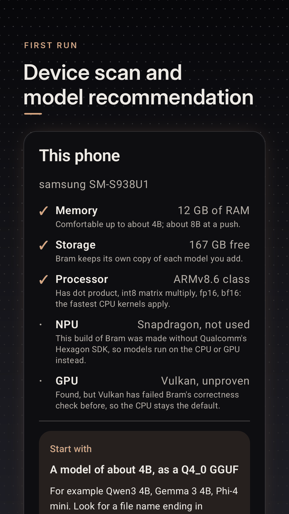
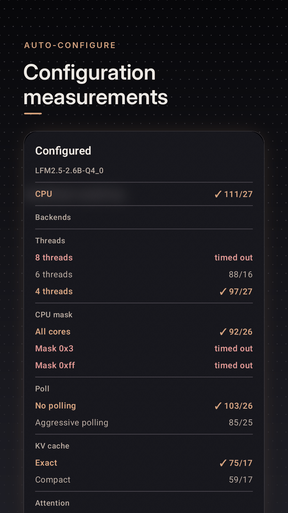
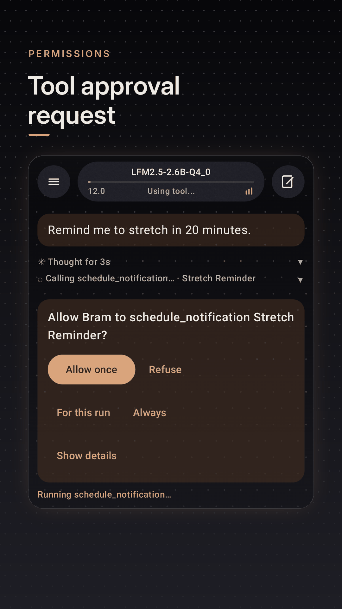
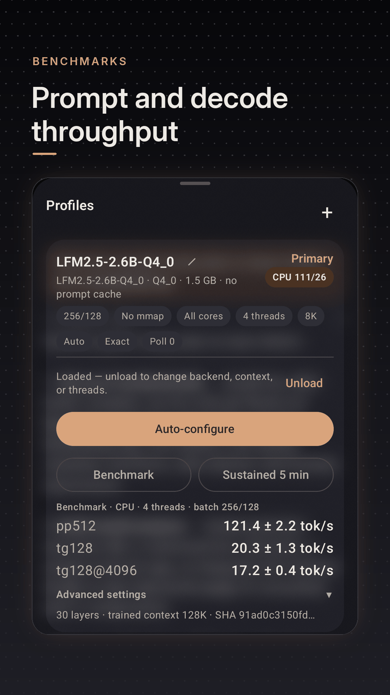

  <picture>
    <source media="(prefers-color-scheme: dark)" srcset="docs/assets/bram-banner.svg" />
    <source media="(prefers-color-scheme: light)" srcset="docs/assets/bram-banner-light.svg" />
    
  </picture>

  
  
  
  

  <a href="https://github.com/KuRue/bram/releases"><b>Releases</b></a> ·
  <a href="docs/BUILDING.md">Build it</a> ·
  <a href="ARCHITECTURE.md">Architecture</a> ·
  <a href="docs/PROJECT_OVERVIEW.md">Status</a> ·
  <a href="ROADMAP.md">Roadmap</a> ·
  <a href="CONTRIBUTING.md">Contribute</a>

## Bram for Android

Bram runs GGUF and LiteRT-LM models on Android and connects to OpenAI-compatible servers.
It includes conversations, tools, memory, and scheduled tasks. Local execution and remote
routing are controlled by the conversation’s privacy settings.

  
  
  
  
  

Real captures from a Galaxy S25 Ultra running LFM2.5-2.6B on the CPU.

| Conversations | Tools and tasks | Hardware configuration |
| :--- | :--- | :--- |
| Persistent threads, Markdown, streaming, and background runs. | Permission-gated tools, remote MCP, versioned skills, and scheduled automations. | Device profiling, memory-aware plans, accelerator validation, and fallback. |

## Get Bram

**Android 10+ · ARM64 · bring your own model or server**

- **[Releases](https://github.com/KuRue/bram/releases):** a signed APK and `SHA256SUMS`, once a version is published.
- **[CI builds](https://github.com/KuRue/bram/actions/workflows/android-ci.yml):** the `bram-debug-…` artifact of any green run (GitHub sign-in required).
- **[Build it yourself](docs/BUILDING.md).**

On first launch, the setup guide checks your phone and suggests what to add. Models are separate
downloads: get a `.gguf` or `.litertlm` file (for example from Hugging Face), or connect a server
such as Ollama or LM Studio. Release and CI builds are signed with different keys; see
[APK releases](docs/RELEASING.md) before switching between them.

## Where things stand

Bram is **alpha**. Chat, conversations, tools, memory, skills, and automations work; hardware
results come from one Snapdragon 8 Elite phone.

| Backend | Evidence |
| :--- | :--- |
| llama.cpp CPU | Validated, with Arm KleidiAI kernels |
| Hexagon NPU | Validated at 95.8% agreement; needs Qualcomm's SDK, so not in release builds |
| OpenCL (Adreno) | Validated at 96% agreement; opt-in at build time |
| Vulkan | Fails validation on the Adreno 830; not used by default |
| LiteRT-LM | Runs `.litertlm` on CPU or GPU; not yet validated across devices |

Full status: [project overview](docs/PROJECT_OVERVIEW.md). What's next: [roadmap](ROADMAP.md).
How it works: [architecture](ARCHITECTURE.md). Everything else: [docs index](docs/README.md).

No open-source license has been selected yet.
